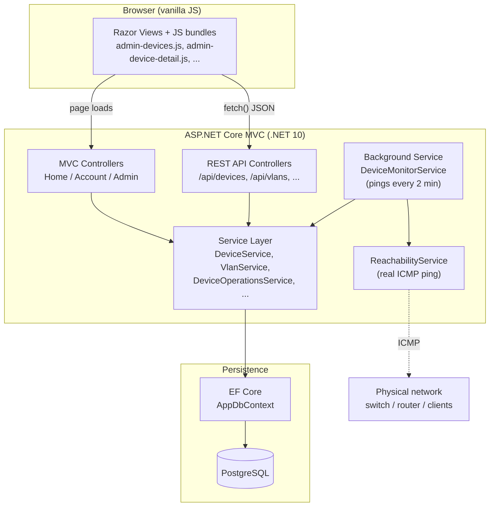
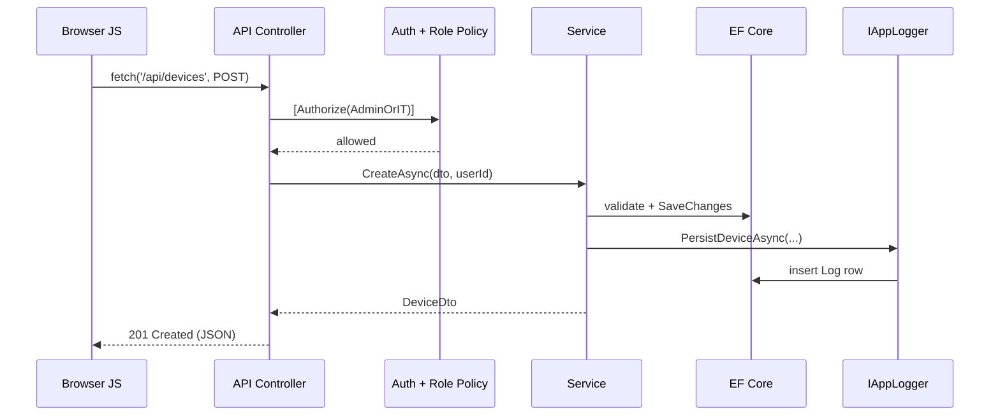
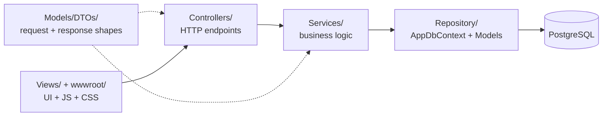
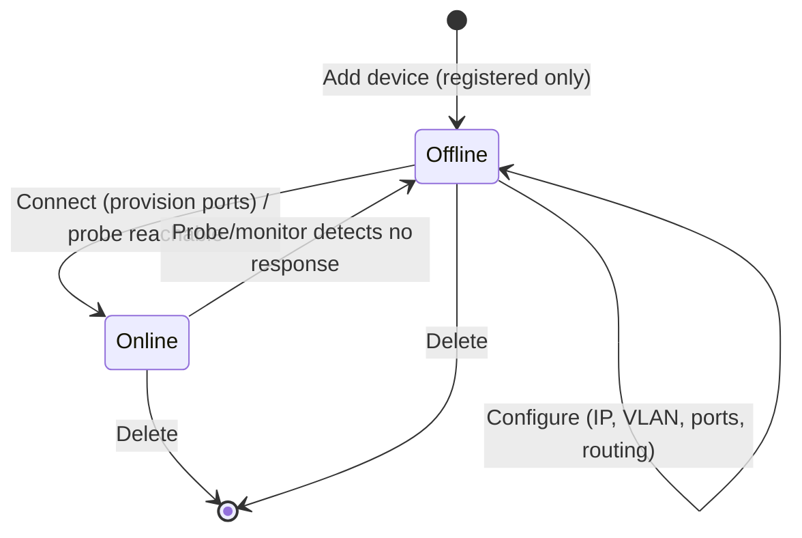
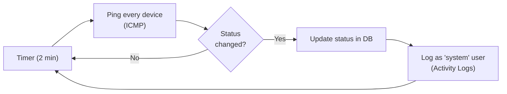
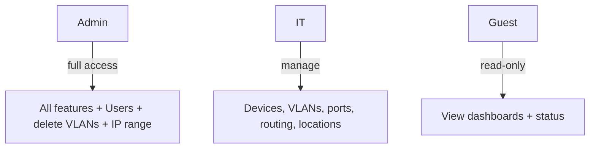

# Network Management App — Development Guide

A concise overview of **how this app was built**: its architecture, the layers, and the
key flows. The app is an **ASP.NET Core MVC** application (.NET 10) with REST API
controllers, server-rendered Razor *Views*, a vanilla-JS front-end, EF Core + PostgreSQL,
and a background monitoring service.

> Note: this is **MVC** (Controllers + Views + attribute-routed APIs), not Razor Pages.

---

## 1. High-level architecture



---

## 2. Request lifecycle (typical API call)



---

## 3. Layered structure (folders)



| Layer | Responsibility | Examples |
|-------|----------------|----------|
| **Controllers** | HTTP, routing, auth, status codes | `DevicesController`, `DeviceOperationsController`, `AdminController` |
| **Services** | Business rules, logging, validation | `DeviceService`, `VlanService`, `DeviceOperationsService` |
| **Repository** | EF Core `DbContext`, entities, relationships | `AppDbContext`, `Device`, `Vlan`, `Port`, `StaticRoute` |
| **DTOs** | Decoupled request/response models | `DeviceDto`, `SaveVlanDto`, `ProbeResultDto` |
| **Views + wwwroot** | Server-rendered pages, JS, CSS | `Device.cshtml`, `admin-device-detail.js` |

---

## 4. The device lifecycle (the core domain flow)



- **Add** ? device stored as `Offline` (no network action).
- **Connect** ? marks `Online`, seeds default ports. *(SSH provisioning is a future TODO.)*
- **Probe** ? real ICMP ping; updates status to reflect reality.
- **Monitor** ? background sweep every 2 min keeps all statuses in sync.

---

## 5. Automatic monitoring loop



---

## 6. Roles & access (cross-cutting)



Enforced at the API via policies (`AdminOnly`, `AdminOrIT`) and mirrored in the UI.

---

## 7. How it was built — step by step

1. **Foundation** — MVC project, EF Core + PostgreSQL, cookie auth, role policies, `DataSeeder`.
2. **Core entities** — Users, Roles, Devices, DeviceTypes, Locations, Logs.
3. **Activity logging** — `IAppLogger` persists auditable actions; categorized log viewer.
4. **Network settings** — admin-managed IP range; device IPs validated/suggested against it.
5. **Device management** — CRUD, unique IPv4 validation, connect-on-demand workflow.
6. **Device operations** — probe, status, change IP, VLAN attach/detach, move, ports, routing.
7. **Device detail page** — full-page view with a right-hand action sidebar (role-aware).
8. **Real reachability** — `ReachabilityService` (ICMP) + `DeviceMonitorService` (2-min sweeps).
9. **System audit** — reserved `system` account attributes automated status changes.
10. **Deployment** — published to IIS (LanTest environment) for local/LAN testing.

---

## 8. Tech stack

| Area | Technology |
|------|-----------|
| Framework | ASP.NET Core **MVC**, .NET 10, C# 14 |
| Data | EF Core, PostgreSQL (Npgsql) |
| Auth | Cookie authentication + role-based policies |
| Front-end | Razor Views, vanilla JS, WebOptimizer bundling |
| Background | `BackgroundService` (hosted) + ICMP ping |
| Hosting | IIS (`AspNetCoreModuleV2`, in-process) |
```
